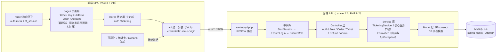
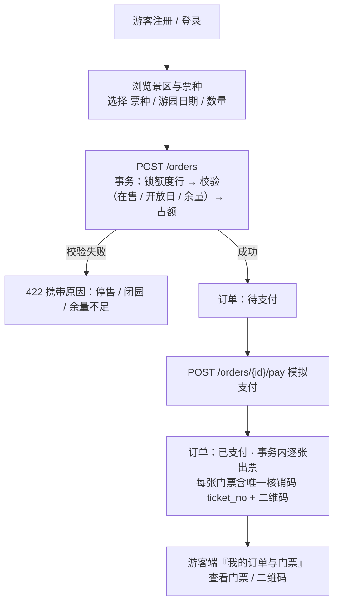
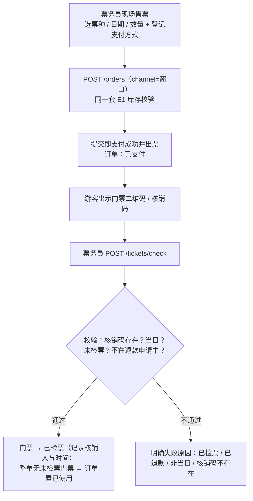
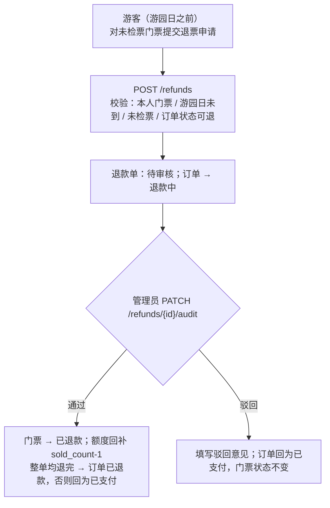
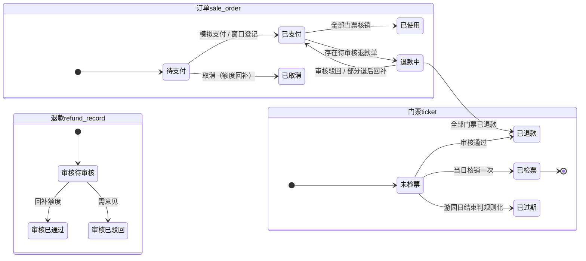
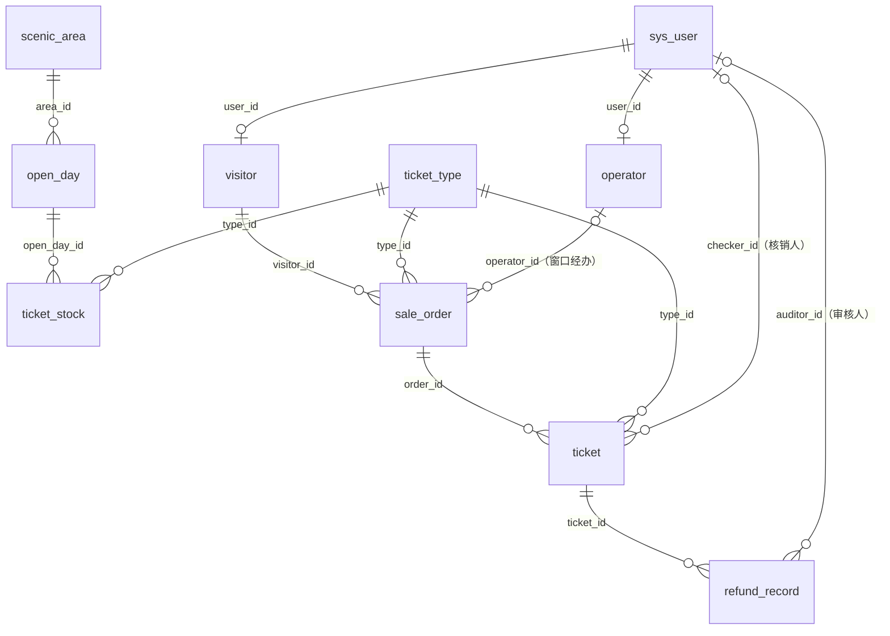

# 景区售票系统 课程设计说明书（概要设计 + 详细设计）

> 课题名称：景区售票系统的设计与实现
> 文档版本：v1.0　　编制日期：2026-10-26
> 前置文档：《景区售票系统 需求规格说明书 v1.0》（本仓库 `docs/景区售票系统需求文档.md`）
>
> **技术口径说明**：需求文档 v1.0 的技术方案原定为 Spring Boot + MyBatis；实际实现采用 **PHP 8.2 + Laravel 12 + Eloquent ORM + Vue 3**。本设计文档按**实际实现的技术栈**编写：业务角色、功能点（F01–F15）、增强功能（E1/E2）、数据库十表与状态机口径均与需求文档保持一致，后端框架层设计（认证、拦截、事务、异常收口）按 Laravel 的对应机制描述。

---

## 目录

- [1 引言](#1-引言)
- [2 概要设计](#2-概要设计)
  - 2.1 运行环境与技术选型
  - 2.2 总体架构
  - 2.3 统一接口与响应规范
  - 2.4 角色与权限设计
  - 2.5 功能模块划分
  - 2.6 业务流程与状态机设计
- [3 详细设计](#3-详细设计)
  - 3.1 数据库详细设计
  - 3.2 核心业务逻辑详细设计（Service 层）
  - 3.3 后端接口详细设计（Controller 层）
  - 3.4 前端详细设计
  - 3.5 安全设计
  - 3.6 部署设计
- [附录 A　需求功能点 → 实现载体对照表](#附录-a需求功能点--实现载体对照表)

---

## 1 引言

### 1.1 编写目的

本文档在《景区售票系统 需求规格说明书》的基础上给出系统的**概要设计**与**详细设计**，作为编码实现与毕业论文设计章节的直接依据。预期读者：课题指导教师、课题承担者（开发者）、答辩评审。

### 1.2 项目背景（详见需求文档第 1 章）

面向中小型景区构建 B/S 架构的售票与票务管理系统，替代"窗口排队买票 + 纸质门票 + 手工统计"的传统方式，打通 **线上购票 → 出票 → 检票核销 → 退票审核** 的业务闭环，实现限量可控（每日售票额度 + 防超卖）与数据决策（ECharts 看板）。

### 1.3 术语与缩写

| 术语 | 说明 |
| --- | --- |
| P / F / E 编号 | 设计阶段功能点（P：页面） / 需求功能点（F01–F15） / 增强功能（E1、E2） |
| 游园日期 / 当日有效 | 门票仅可于 `visit_date` 当天核销一次 |
| 核销码 | 门票唯一编码 `ticket_no`，二维码内容即编码字符串 |
| 额度占用表 | `ticket_stock`，"开放式日期 × 票种"的每日可售额度（`quota`）与已售计数（`sold_count`） |
| Session 登录态 | 服务端 Session（`PHPSESSID` Cookie 承载）中的 `uid` 键校验 |
| 滑动过期 | 会话活动时自动续期；默认 30 分钟 |

### 1.4 参考资料

1. 《景区售票系统 需求规格说明书 v1.0》
2. 《信息学院毕业设计任务书（指导教师：刘艳梅，教授）》
3. Laravel Framework 12 官方文档 / Vue.js 3 官方文档 / MySQL 8.4 Reference Manual

---

## 2 概要设计

### 2.1 运行环境与技术选型

```
前端  Vue 3.5（组合式 API）+ Vue Router 4 + Pinia 2 + Vite 6 + 原生 CSS（自研设计令牌）
      二维码：演示用 SVG 示意二维码组件（正式可替换 qrcode 库）
后端  PHP 8.2 + Laravel 12（路由 / 中间件 / Eloquent ORM / 数据库事务）
      口令 BCrypt（bcrypt()，等效 spring-security-crypto 的 BCryptPasswordEncoder）
      参数校验 Validation API（等效 @Valid + 全局处理器）
数据  MySQL 8.4 LTS（utf8mb4）+ Laravel 数据库迁移（migrations）管理表结构
工具  Node.js 22+ / PHP 8.2 / Composer / Git
部署  前端 dist 静态托管（Nginx 反代同域 /api）+ 后端 artisan serve（或 php-fpm + Nginx / Octane）
```

> 与需求文档原方案的映射：`Spring MVC 拦截器` → `Laravel 中间件（EnsureLogin / EnsureRole）`；`HttpSession` → `Laravel StartSession + session('uid')`（Session 驱动为数据库表 `sessions`）；`MyBatis` → `Eloquent ORM`（同样基于参数化查询）；`@RestControllerAdvice` → `bootstrap/app.php` 的 `withExceptions` 异常渲染收口。

### 2.2 总体架构

系统为**前后端分离的 B/S 架构**：前端为 Vue 3 单页应用（SPA），后端为 Laravel 提供的纯 JSON API（统一前缀 `/api/**`），开发期由 Vite 代理转发，生产期由 Nginx 反向代理至同域，Cookie 天然同源携带。



**后端分层职责**：

| 层 | 载体 | 职责 | 不允许做的事 |
| --- | --- | --- | --- |
| 路由层 | `routes/api.php` | URL → 控制器映射、中间件分组声明 | 写业务逻辑 |
| 中间件层 | `app/Http/Middleware/EnsureLogin.php`、`EnsureRole.php` | 登录校验（401）、角色校验（403），并把已登录用户注入容器 `authUser` | 写业务逻辑 |
| 控制器层 | `app/Http/Controllers/*Controller.php` | 收参 → 校验 → 调用 Service → `ok()` 返回 | 直接写库/写事务口径 |
| 服务层 | `app/Support/TicketingService.php` | 库存校验、防超卖、出票、核销、退票审核等**事务性业务口径** | 处理 HTTP 细节 |
| 模型层 | `app/Models/*.php` | 表映射、关联（Eloquent 关系）、序列化 | 跨表业务流程 |

**前端分层职责**：`router`（入口与守卫）→ `pages`（页面组件）→ `components`（状态色标 chip、二维码组件）→ `stores`（Pinia：登录态镜像 `st_session` 与本地兜底数据）→ `api`（统一 fetch 封装）。样式集中在 `styles/main.css`，以内置设计令牌（`--ink`、`--border` 等）驱动移动端优先的自适应界面。

### 2.3 统一接口与响应规范

- 基础路径 `/api/**`；全部返回 JSON，统一封装三字段 `{code, message, data}`，`code = 200` 成功；
- 登录态由 Cookie（`PHPSESSID`）承载，前端请求 `credentials: 'same-origin'`；未登录 / 会话过期返回 `code=401`；
- 业务码语义：`200` 成功、`401` 未登录、`403` 无权限、`404` 资源不存在、`422` 参数或业务校验不通过、其余 `4xx` 为拒绝原因，`5xx` 为服务异常；
- 异常收口在 `bootstrap/app.php`：`ValidationException` → 422（取第一条错误）、`AuthenticationException` → 401、`ModelNotFound/NotFound` → 404、`App\Support\ApiException`（业务拒绝）→ 按其携带的 code 输出 `message`；
- 数据范围过滤：三端共用的 `orders` / `tickets` 等资源按 `/my`（游客本人）、`/mine`（票务员经办）区分，服务端按登录身份过滤数据。

### 2.4 角色与权限设计

三个角色：**游客（visitor）**、**票务员（operator）**、**系统管理员（admin）**，均存于 `sys_user.role` 单字段。

| 环节 | 机制 | 实现 |
| --- | --- | --- |
| 登录态建立 | `POST /api/auth/login` 校验口令后在 Session 中写入 `uid`（`AuthController::login`） | 数据库 Session 驱动，Cookie `PHPSESSID`，滑动过期默认 30 分钟 |
| 登录拦截 | `auth.session`（EnsureLogin）作用于除 auth 公开与 `/api/area`、`/api/enums` 之外的 `/api/**` | `session('uid')` 为空 → 401；账号不存在或停用 → 清除会话并 401；通过后 `authUser` 注入请求与容器 |
| 角色校验 | `auth.role:admin` / `auth.role:operator` 中间件别名（EnsureRole） | 与需求文档"前端守卫 + 角色字段"分级口径一致：后端管端与检票接口按角色硬校验（403），游客端数据范围按归属过滤 |
| 前端守卫 | `router.beforeEach`：`meta.auth` 页面读取 `st_session` 本地镜像，未登录重定向 | 实际鉴权以后端为准，本地镜像仅用于快速跳转 |
| 数据范围 | 游客端仅见 `visitor_id = 本人`；票务员仅见 `operator_id = 本人` 的窗口订单与核销记录；管理端不限制 | 需求文档第 7 章"角色过滤"口径 |

### 2.5 功能模块划分

#### 2.5.1 游客端（前端 SPA）

| 模块 | 功能点 | 说明 | 页面 / 接口 |
| --- | --- | --- | --- |
| 身份登录 | F01 | 用户名 + 口令注册（自助注册默认 visitor）、登录 / 登出、个人中心（我的信息、修改口令） | `LoginPage`、`AccountPage`；`/api/auth/*` |
| 景区与票种浏览 | F02 | 景区公告、开放时间、地址；票种名称 / 单价 / 适用人群 / 剩余额度；七日内"游园日期 × 票种"可售情况 | `HomePage`；`/api/area`（公开） |
| 在线购票 | F03 | 选票种 / 游园日期 / 数量 → 校验（E1）→ 待支付 → 模拟支付 → 出票生成门票与核销码 | `BuyPage`；`POST /orders`、`/orders/{id}/pay` |
| 我的订单与门票 | F04 | 订单列表（状态筛选 / 分页）、门票明细与二维码、未检票门票退票申请；我的购票概要（可视化） | `OrdersPage`；`/orders/my`、`/tickets/order/{id}`、`/refunds` |

#### 2.5.2 票务员端

| 模块 | 功能点 | 说明 | 接口 |
| --- | --- | --- | --- |
| 票务工作台 | F05 | 今日售票量、今日入园（待核销）量、本人今日交易额、近期入园趋势 | `GET /operator/workbench` |
| 现场售票 | F06 | 代客选票种 / 日期 / 数量下单，登记线下支付（现金 / 扫码），提交即出票（`channel=窗口`，同一套 E1 校验） | `POST /orders`（按登录角色识别渠道） |
| 检票核销 | F07 | 核销码（或扫码）→ 校验当日有效 / 未检票 / 非退款中 → 置已检票 | `POST /tickets/check` |
| 我的售票记录 | F08 | 本人经手窗口订单 + 核销记录，按日期 / 状态查询 | `GET /orders/mine` |

#### 2.5.3 后台管理端

| 模块 | 功能点 | 说明 | 接口 |
| --- | --- | --- | --- |
| 工作台 | F09 | 指标卡（今日售票量 / 入园量 / 收入 / 待审核退票数）+ 待办 | `GET /statistics/overview` |
| 景区与票种管理 | F10 | 景区信息维护、开放日历维护（开放 / 闭园 / 容量）、票种增删改查（ADULT / CHILD / STUDENT / SENIOR …） | `/api/area`、`/open-days`、`/ticket-types` |
| 售票额度管理 | F11 | "开放日期 × 票种"额度设置（不少于已售数）、剩余额度与已售进度、停售指定日期票种 | `GET /open-days`、`PUT /stocks/{id}` |
| 订单管理 | F12 | 全量订单多条件组合查询（订单号 / 状态 / 渠道 / 日期）+ 分页；订单门票明细 | `GET /orders`、`/tickets` |
| 退票审核 | F13 | 待审核列表、通过 / 驳回（写审核意见）；通过后自动回补额度并更新门票与订单状态 | `GET /refunds/pending`、`PATCH /refunds/{id}/audit` |
| 统计报表 | F14 | 见 E2（六类图表 + 统一筛选） | `GET /statistics/overview` |
| 用户管理 | F15 | 账号增删改查、启停用、角色分配（含游客 / 票务员建号与关联档案） | `/api/users`、`/visitors`、`/operators` |

#### 2.5.4 增强功能

- **E1 每日额度库存校验与防超卖（核心保障）**：下单 / 出票在同一数据库事务内完成"**按主键锁定额度行 → 校验 → 累加占额**"，杜绝并发把额度击穿；详见 3.2.1。
- **E2 运营数据可视化看板**：`/api/statistics/overview` 一次聚合返回六组数据（byDay / byType / byChannel / checkedByDay / refundCount / ticketCount + today 指标），前端以 ECharts 承载售票趋势折线图、票种结构饼图、渠道 / 票种收入柱线图、入园与核销率柱线图、退票率仪表盘；游客端以统计卡呈现本人购票概要（F04）。支持 `start / end` 时间范围筛选。

### 2.6 业务流程与状态机设计

#### 2.6.1 线上购票主流程（需求文档 3.1）



#### 2.6.2 现场票务与检票流程（需求文档 3.2）



#### 2.6.3 退票与退款流程（需求文档 3.3）



#### 2.6.4 状态机



---

## 3 详细设计

### 3.1 数据库详细设计

#### 3.1.1 设计约定

| 约定项 | 规则 |
| --- | --- |
| 数据库 / 字符集 | MySQL 8.4 LTS，库名 `scenic_ticket`，字符集 `utf8mb4`，引擎 InnoDB |
| 表结构管理 | Laravel 迁移（`database/migrations/*`）；`0001_…_create_master_tables.php`（主数据）+ `…_create_business_tables.php`（流水） |
| 主键 | 各表自增 `id BIGINT` |
| 命名 | 小写下划线；唯一索引前缀 `uk_`、普通索引前缀 `idx_`；避免保留字 `order`，采用 `sale_order` |
| 外键约束 | 全部显式声明 FK：档案表对 `sys_user` 为级联删除（`cascadeOnDelete`）；流水表对删改敏感主数据（如 `ticket_type`）用 `restrictOnDelete` 保护；经办人 / 审核人删除时置空（`nullOnDelete`） |
| 时间 | 业务时间 `DATETIME`；仅日期 `DATE`；`create_time` 默认当前时间 |
| 金额 | `DECIMAL(10,2)` |
| 逻辑删除 | 主数据 6 表（`sys_user / visitor / operator / scenic_area / open_day / ticket_type / ticket_stock`）含 `del_flag`；业务流水 3 表不删除、仅状态流转 |
| 敏感信息 | 游客身份证号 AES 加密存储、展示保留前 6 后 4；口令 BCrypt 单向加密 |
| 冗余计数 | `ticket_stock.sold_count`、`sale_order.ticket_count` 为冗余缓存，由业务写入同步更新，剩余额度 = `quota − sold_count` 不单独存 |
| Session 存储 | `sessions` 表（Laravel 数据库 Session 驱动） |

#### 3.1.2 表清单与实体关系

| 表名 | 说明 | 类型 |
| --- | --- | --- |
| `sys_user` | 登录用户（管理员 / 票务员 / 游客） | 主数据 |
| `visitor` | 游客档案 | 主数据 |
| `operator` | 票务员档案 | 主数据 |
| `scenic_area` | 景区信息 | 主数据 |
| `open_day` | 园区开放日期 | 主数据 |
| `ticket_type` | 票种（含价格） | 主数据 |
| `ticket_stock` | 每日售票额度 | 主数据 |
| `sale_order` | 售票订单 | 流水 |
| `ticket` | 门票（含核销码） | 流水 |
| `refund_record` | 退票申请与审核 | 流水 |



#### 3.1.3 表结构详细设计

##### ① `sys_user` 登录用户

| 字段 | 类型 | 约束 | 说明 |
| --- | --- | --- | --- |
| id | BIGINT | PK, AUTO_INCREMENT | 主键 |
| username | VARCHAR(50) | NOT NULL, UNIQUE `uk_username` | 登录名 |
| password | VARCHAR(100) | NOT NULL | BCrypt 密文（`bcrypt()`） |
| name | VARCHAR(50) | NOT NULL | 显示姓名（各档案表不再重复存姓名） |
| role | VARCHAR(20) | NOT NULL DEFAULT 'visitor' | admin / operator / visitor |
| status | TINYINT | NOT NULL DEFAULT 1 | 1 启用 / 0 停用 |
| create_time | TIMESTAMP | NOT NULL DEFAULT CURRENT_TIMESTAMP | 创建时间 |
| del_flag | TINYINT | NOT NULL DEFAULT 0 | 逻辑删除（0 正常 / 1 删除） |

##### ② `visitor` 游客档案

| 字段 | 类型 | 约束 | 说明 |
| --- | --- | --- | --- |
| id | BIGINT | PK | 主键 |
| user_id | BIGINT | NOT NULL, UNIQUE `uk_user`, FK → `sys_user.id` 级联删除 | 关联登录账号 |
| id_card | VARCHAR(64) | NULL, UNIQUE `uk_id_card` | 身份证号（AES 密文，展示脱敏前 6 后 4） |
| phone | VARCHAR(20) | NULL | 联系电话 |
| status | VARCHAR(20) | NOT NULL DEFAULT '正常', INDEX `idx_status` | 正常 / 停用 |
| del_flag | TINYINT | NOT NULL DEFAULT 0 | 逻辑删除 |

##### ③ `operator` 票务员档案

| 字段 | 类型 | 约束 | 说明 |
| --- | --- | --- | --- |
| id | BIGINT | PK | 主键 |
| user_id | BIGINT | NOT NULL, UNIQUE `uk_user`, FK → `sys_user.id` 级联删除 | 关联登录账号 |
| code | VARCHAR(20) | NOT NULL, UNIQUE `uk_code` | 票务工号 |
| window_no | VARCHAR(20) | NULL | 常用窗口编号 |
| phone | VARCHAR(20) | NULL | 联系电话 |
| status | VARCHAR(10) | NOT NULL DEFAULT '在职' | 在职 / 停用 |
| del_flag | TINYINT | NOT NULL DEFAULT 0 | 逻辑删除 |

##### ④ `scenic_area` 景区信息

| 字段 | 类型 | 约束 | 说明 |
| --- | --- | --- | --- |
| id | BIGINT | PK | 主键 |
| name | VARCHAR(50) | NOT NULL | 景区名称 |
| description | VARCHAR(500) | NULL | 景区简介 |
| address | VARCHAR(100) | NULL | 地址 |
| open_time | VARCHAR(50) | NULL | 开放时间（如 08:30–17:00） |
| notice | VARCHAR(255) | NULL | 游园公告 |
| default_capacity | INT | NOT NULL DEFAULT 5000 | 全局默认每日入园额度兜底 |
| del_flag | TINYINT | NOT NULL DEFAULT 0 | 逻辑删除 |

##### ⑤ `open_day` 园区开放日期

| 字段 | 类型 | 约束 | 说明 |
| --- | --- | --- | --- |
| id | BIGINT | PK | 主键 |
| area_id | BIGINT | NOT NULL, FK → `scenic_area.id` 级联删除 | 景区 |
| open_date | DATE | NOT NULL | 游园日期 |
| capacity | INT | NOT NULL DEFAULT 5000 | 当日入园总容量 |
| status | VARCHAR(10) | NOT NULL DEFAULT '开放' | 开放 / 闭园 |
| del_flag | TINYINT | NOT NULL DEFAULT 0 | 逻辑删除 |

约束：UNIQUE `uk_area_date`(area_id, open_date)；索引 `idx_date(open_date)`。

##### ⑥ `ticket_type` 票种

| 字段 | 类型 | 约束 | 说明 |
| --- | --- | --- | --- |
| id | BIGINT | PK | 主键 |
| type_code | VARCHAR(20) | NOT NULL, UNIQUE `uk_code` | 票种编码（ADULT / CHILD / STUDENT / SENIOR …） |
| type_name | VARCHAR(50) | NOT NULL | 票种名称（成人票 / 儿童票 …） |
| price | DECIMAL(10,2) | NOT NULL | 现售价 |
| applicable | VARCHAR(100) | NULL | 适用人群说明 |
| refundable | TINYINT | NOT NULL DEFAULT 1 | 1 可退 / 0 不可退 |
| status | VARCHAR(10) | NOT NULL DEFAULT '在售' | 在售 / 停售 |
| del_flag | TINYINT | NOT NULL DEFAULT 0 | 逻辑删除 |

##### ⑦ `ticket_stock` 每日售票额度（E1 核心）

| 字段 | 类型 | 约束 | 说明 |
| --- | --- | --- | --- |
| id | BIGINT | PK | 主键 |
| open_day_id | BIGINT | NOT NULL, FK → `open_day.id` 级联删除 | 对应开放日 |
| type_id | BIGINT | NOT NULL, FK → `ticket_type.id` 级联删除, INDEX `idx_type_date` | 票种 |
| quota | INT | NOT NULL | 当日该票种可售额度 |
| sold_count | INT | NOT NULL DEFAULT 0 | 已出票张数（冗余缓存，事务内同步累加 / 回补） |
| status | VARCHAR(10) | NOT NULL DEFAULT '正常' | 正常 / 已售罄 / 停售 |
| del_flag | TINYINT | NOT NULL DEFAULT 0 | 逻辑删除 |

约束：UNIQUE `uk_day_type`(open_day_id, type_id)。剩余额度 = `quota − sold_count`，不冗余存"剩余"字段。

##### ⑧ `sale_order` 售票订单

| 字段 | 类型 | 约束 | 说明 |
| --- | --- | --- | --- |
| id | BIGINT | PK | 主键 |
| order_no | VARCHAR(32) | NOT NULL, UNIQUE `uk_order_no` | 订单号：`SO` + yyyyMMdd + 4 位当日流水 |
| visitor_id | BIGINT | NOT NULL, FK → `visitor.id` | 购票游客 |
| type_id | BIGINT | NOT NULL, FK → `ticket_type.id`（restrict） | 票种 |
| visit_date | DATE | NOT NULL, INDEX `idx_visit_date` | 游园日期（出票后不可改） |
| quantity | INT | NOT NULL | 购买张数 |
| unit_price | DECIMAL(10,2) | NOT NULL | 下单时单价快照 |
| total_amount | DECIMAL(10,2) | NOT NULL | 实付金额 = unit_price × quantity |
| channel | VARCHAR(10) | NOT NULL DEFAULT '线上' | 线上 / 窗口 |
| pay_method | VARCHAR(20) | NULL | 模拟支付 / 现金 / 扫码 / 线下 |
| pay_time | DATETIME | NULL | 支付完成时间 |
| operator_id | BIGINT | NULL, FK → `operator.id` 置空删除 | 窗口经办票务员（线上为空） |
| status | VARCHAR(10) | NOT NULL DEFAULT '待支付' | 待支付 / 已支付 / 已使用 / 退款中 / 已退款 / 已取消 |
| cancel_time / refund_time | DATETIME | NULL | 取消时间 / 整单退款完成时间 |
| create_time | TIMESTAMP | NOT NULL DEFAULT CURRENT_TIMESTAMP | |

索引：`idx_visitor_status(visitor_id, status)`、`idx_visit_date(visit_date)`；订单明细以 `ticket` 表为据（一单多票）。

##### ⑨ `ticket` 门票

| 字段 | 类型 | 约束 | 说明 |
| --- | --- | --- | --- |
| id | BIGINT | PK | 主键 |
| ticket_no | VARCHAR(32) | NOT NULL, UNIQUE `uk_ticket_no` | 核销码：`TK` + 12 位 32 进制字符集（去 0/O/1/I，`random_int` 生成，生成后查重重试）；二维码即编码内容 |
| order_id | BIGINT | NOT NULL, FK → `sale_order.id` 级联删除, INDEX `idx_order` | 所属订单 |
| type_id | BIGINT | NOT NULL, FK → `ticket_type.id`（restrict） | 票种（冗余自订单，便于查询） |
| visit_date | DATE | NOT NULL | 游园日期（核销有效期判断） |
| unit_price | DECIMAL(10,2) | NOT NULL | 张票价（订单单价快照，退票退款金额依据） |
| status | VARCHAR(10) | NOT NULL DEFAULT '未检票' | 未检票 / 已检票 / 已退款 / 已过期 |
| check_time | DATETIME | NULL | 核销时间 |
| checker_id | BIGINT | NULL, FK → `sys_user.id` 置空删除 | 核销人（票务员） |
| create_time | TIMESTAMP | NOT NULL DEFAULT CURRENT_TIMESTAMP | |

索引：`idx_order(order_id)`、`idx_visit_date_status(visit_date, status)`；不单存退款金额（等于 `unit_price`）；"已过期"由定时任务或查询时判规则化写入。

##### ⑩ `refund_record` 退票申请与审核

| 字段 | 类型 | 约束 | 说明 |
| --- | --- | --- | --- |
| id | BIGINT | PK | 主键 |
| ticket_id | BIGINT | NOT NULL, FK → `ticket.id` 级联删除, INDEX `idx_ticket` | 申请退的门票（一票可多次申请，最新一条生效） |
| visitor_id | BIGINT | NOT NULL, FK → `visitor.id` | 申请游客（窗口代退为办理身份） |
| reason | VARCHAR(255) | NOT NULL | 退票原因 |
| refund_amount | DECIMAL(10,2) | NOT NULL | 退款金额（默认张票价 unit_price） |
| apply_time | DATETIME | NOT NULL DEFAULT CURRENT_TIMESTAMP | 申请时间 |
| audit_status | VARCHAR(10) | NOT NULL DEFAULT '待审核', INDEX `idx_status` | 待审核 / 已通过 / 已驳回 |
| auditor_id | BIGINT | NULL, FK → `sys_user.id` 置空删除 | 审核人 |
| audit_opinion | VARCHAR(255) | NULL | 审核意见（驳回必填） |
| audit_time | DATETIME | NULL | 审核时间 |

#### 3.1.4 索引与约束汇总

| 表 | 唯一约束 | 普通索引 | 外键删除策略 |
| --- | --- | --- | --- |
| `sys_user` | `uk_username(username)` | — | — |
| `visitor` | `uk_user(user_id)`、`uk_id_card(id_card)` | `idx_status` | user_id 级联 |
| `operator` | `uk_user(user_id)`、`uk_code(code)` | — | user_id 级联 |
| `open_day` | `uk_area_date(area_id,open_date)` | `idx_date` | area_id 级联 |
| `ticket_type` | `uk_code(type_code)` | — | — |
| `ticket_stock` | `uk_day_type(open_day_id,type_id)` | `idx_type_date` | 双 FK 级联 |
| `sale_order` | `uk_order_no(order_no)` | `idx_visitor_status`、`idx_visit_date` | visitor 级联；type 限制；operator 置空 |
| `ticket` | `uk_ticket_no(ticket_no)` | `idx_order`、`idx_visit_date_status` | order 级联；type 限制；checker 置空 |
| `refund_record` | — | `idx_ticket`、`idx_status` | ticket/visitor 级联；auditor 置空 |
| `scenic_area` | — | — | — |

#### 3.1.5 枚举值约定（服务端常量，`GET /api/enums` 下发）

| 枚举 | 取值 |
| --- | --- |
| `orderStatus` | 待支付 / 已支付 / 已使用 / 退款中 / 已退款 / 已取消 |
| `ticketStatus` | 未检票 / 已检票 / 已退款 / 已过期 |
| `refundStatus` | 待审核 / 已通过 / 已驳回 |
| `channel` | 线上 / 窗口 |
| `payMethod` | 模拟支付 / 现金 / 扫码 |
| `typeStatus` | 在售 / 停售 |
| `sys_user.role` | admin / operator / visitor |

---

### 3.2 核心业务逻辑详细设计（Service 层）

核心业务全部收口在 `app/Support/TicketingService.php`，一律以 `DB::transaction()` 包裹，借 Laravel 门面操作 Eloquent 模型；校验失败抛 `App\Support\ApiException`（携带明确业务原因与状态码），由全局异常收口转换为 `{code, message}`。**步骤顺序固定为"锁行 → 校验 → 写入"，行锁使用 `lockForUpdate()`（InnoDB `SELECT … FOR UPDATE`）。**

#### 3.2.1 E1 下单与防超卖 `createOrder()`

事务内按序执行：

```
BEGIN TRANSACTION
1  查票种：del_flag=0 且 status='在售'；否则抛"该票种已停售，请重新选择"
2  查开放日：open_date={visitDate} 且 status='开放'；否则抛"该日期闭园或未开放…"
3  查额度行：open_day_id × type_id，lockForUpdate() 行锁
      （并发下单在此串行化：后到事务等待行锁，读到的是前面事务占额后的最新 sold_count）
4  校验余量：rest = max(0, quota − sold_count) ≥ quantity
      否则抛"该日期“{票名}”仅剩 {rest} 张，请减少数量或另选日期"
5  占额：sold_count += quantity；若 sold_count ≥ quota → 置 status='已售罄'
6  生成订单号 SO+Ymd+4位流水，创建 sale_order（status=待支付, unit_price=下单时价格快照,
      total_amount=unit_price×quantity, channel=线上/窗口, operator_id=窗口经办人）
7  渠道为"窗口"：调用 payOrder()（事务内嵌套 transaction 同事务执行）——提交即支付并出票
COMMIT / 异常自动回滚（含已累加的 sold_count）
```

> 防超卖设计要点：①粒度为"开放日期 × 票种"单行，冲突域明确，锁等待时间短（事务内无耗时 IO）；②唯一约束 `uk_day_type` 保证额度行唯一，加盟并发不重复建行；③取消 / 退票审核通过时的回补使用 `max(0, …)` 下界保护并恢复"已售罄 → 正常"；④校验与占额在同一事务，杜绝"查得到、占不了"的超卖窗口。

**开放日与额度滚动保障 `ensureOpenDays()`**：保证未来 7 天恒存在开放日（`capacity` 取景区 `default_capacity`，status=开放）与各在售票种的额度行（默认额度 ADULT=500 / CHILD=200 / STUDENT=200 / SENIOR=150，其他 300），`firstOrCreate` 幂等，供 `/api/area` 展示与下单预检使用。

#### 3.2.2 模拟支付与出票 `payOrder()`

```
BEGIN TRANSACTION
1  锁订单行（lockForUpdate），校验 status='待支付'，否则"订单状态已变化，仅待支付订单可支付"
2  订单 → 已支付；pay_time=now()；pay_method 缺省置"模拟支付"
3  逐张出票 ×quantity：ticket_no = "TK" + 12 位随机（字符集
      ABCDEFGHJKLMNPQRSTUVWXYZ23456789，排除易混淆 0/O/1/I；查重后重试），
      冗余 type_id / visit_date / unit_price 快照，status='未检票'
COMMIT
```

出票后前端以 `QrMock` 组件将 `ticket_no` 渲染为 SVG 示意二维码（正式环境可替换为 `qrcode` 库真码），游客在"我的订单与门票"出示。

#### 3.2.3 取消待支付订单 `cancelOrder()`

锁订单行 → 校验 `status='待支付'` → 置 `已取消`、记 `cancel_time` → 事务内找到对应额度行，`sold_count = max(0, sold_count − quantity)`；若原为"已售罄"且余量恢复 > 0，置回"正常"。

#### 3.2.4 检票核销 `checkTicket(ticketNo, checker)`

| 序 | 校验项 | 失败提示 | 失败码 |
| --- | --- | --- | --- |
| 1 | 核销码存在 | 核销码不存在，请核对后重试 | 404 |
| 2 | 状态 = 未检票 | 已检票则提示"请勿重复核销"；其他状态提示当前状态 | 422 |
| 3 | `visit_date` = 当日 | 该门票非当日有效，不能核销 | 422 |
| 4 | 无"待审核"退票申请 | 该门票存在待审核的退票申请，暂不能核销 | 422 |

通过后：置 `已检票`、记 `check_time` 与 `checker_id`；随后统计该订单仍为"未检票"的张数，为 0 时整单置**已使用**。（一码一次：校验与写入在同一事务行锁内完成，并发重复扫码第二次读到的是"已检票"。）

#### 3.2.5 退票申请 `requestRefund(visitor, ticketNo, reason)`

| 序 | 校验项 | 失败码 |
| --- | --- | --- |
| 1 | 核销码存在（404） | 404 |
| 2 | 门票归属本人（403：无权操作该门票） | 403 |
| 3 | 游园日期未到：`visit_date > today()`（当天及之后不可退） | 422 |
| 4 | 门票状态 = 未检票 | 422 |
| 5 | 订单状态 ∈ {已支付, 已使用, 退款中} | 422 |

通过后创建 `refund_record`（`refund_amount = ticket.unit_price`，`audit_status=待审核`），并将订单置**退款中**。未通过校验的申请不落库。

#### 3.2.6 退票审核 `auditRefund(record, approve, opinion, auditor)`

```
BEGIN TRANSACTION
1  锁退款单，校验 audit_status='待审核'，否则"该退款申请已处理"
2  写核：audit_status=已通过/已驳回；audit_opinion；audit_time；auditor_id
3  锁门票与订单行；若驳回 → 订单回置"已支付"，结束
4  若通过：
   4a 门票 → 已退款
   4b 额度回补：join open_day 定位"游园日期 × 订单票种"额度行并锁行，
       sold_count = max(0, sold_count − 1)；售罄状态自动恢复"正常"
   4c 订单归集：仍有非退款门票 → 维持"已支付"；全退完 → "已退款"并记 refund_time
COMMIT
```

> 退款口径（延续需求文档）：本期为**业务层面的退款登记**，不做真实资金退回；单票维度登记退款，订单状态按"全部门票均已退款"判断归集。审核流程全程行锁，避免"同一退款单被重复审核"或"额度重复回补"。

### 3.3 后端接口详细设计（Controller 层）

控制器职责：收参与结构校验（Validation）→ 复杂口径交 `TicketingService` → 出参经 `App\Support\Formatter` 由数据库 snake_case 转前端 camelCase → `ok($data)` 统一返回。

#### 3.3.1 接口总表（对应 `routes/api.php`）

> 标注 ⟂ 的接口需登录（`auth.session`）；标 ⊙ 票务员、标 ▣ 管理员（`auth.role`）。

| 方法 | 路径 | 说明 | 权限 |
| --- | --- | --- | --- |
| POST | `/api/auth/register` | 用户名 + 口令注册（name 必填；默认 visitor；自动建 visitor 档案） | 公开 |
| POST | `/api/auth/login` | 校验口令，建立 Session（写入 uid 与角色） | 公开 |
| POST | `/api/auth/logout` | 销毁 Session | 公开 |
| GET | `/api/area` | 景区信息、票种、未来 7 日开放日与可售情况 / 售罄状态 | 公开 |
| GET | `/api/enums` | 枚举字典 | 公开 |
| GET | `/api/auth/me` | 当前用户信息（角色、票务工号等） | ⟂ |
| PUT | `/api/auth/password` | 修改本人口令（校验原口令） | ⟂ |
| POST | `/api/orders` | 提交订单（渠道按登录角色：游客=线上 / 票务员=窗口代客），E1 校验 | ⟂ |
| GET | `/api/orders/my` | 我的订单（游客本人，状态筛选 / 分页 / 每单含门票明细与最近退单） | ⟂ |
| GET | `/api/orders/mine` | 本人经办窗口订单与核销记录 | ⟂ ⊙ |
| POST | `/api/orders/{id}/pay` | 模拟支付并出票 | ⟂ |
| POST | `/api/orders/{id}/cancel` | 取消待支付订单（额度回补，仅本人） | ⟂ |
| GET | `/api/tickets/order/{orderId}` | 订单门票明细与二维码内容（归属校验） | ⟂ |
| POST | `/api/refunds` | 提交退票申请（单张门票维度） | ⟂ |
| GET | `/api/refunds/mine` | 我的退票申请记录 | ⟂ |
| POST | `/api/tickets/check` | 检票核销 | ⟂ ⊙ |
| GET | `/api/operator/workbench` | 票务工作台指标 | ⟂ ⊙ |
| GET | `/api/orders` | 全量订单多条件检索（orderNo / status / channel / visitDate / 分页） | ⟂ ▣ |
| GET | `/api/tickets` | 门票检索（ticketNo / orderNo / visitDate / 分页） | ⟂ ▣ |
| GET/POST/PUT/DELETE | `/api/users`（`/users/{id}`） | 用户增删改查、启停用、角色分配；建号同步档案 | ⟂ ▣ |
| GET/POST/PUT/DELETE | `/api/ticket-types`（`/{id}`） | 票种增删改查 | ⟂ ▣ |
| GET | `/api/open-days` | 未来开放日历 + 各票种额度余量（含已售进度） | ⟂ ▣ |
| PUT | `/api/open-days/{id}` | 设置开放日（开放 / 闭园、容量） | ⟂ ▣ |
| PUT | `/api/stocks/{id}` | 设置指定额度行 quota（≥ 已售数）与 status | ⟂ ▣ |
| GET | `/api/refunds/pending` | 待审核退票列表（含门票 / 订单 / 游客上下文） | ⟂ ▣ |
| PATCH | `/api/refunds/{id}/audit` | 退票审核（通过 / 驳回） | ⟂ ▣ |
| GET | `/api/statistics/overview` | 统计看板汇总（start / end 筛选） | ⟂ ▣ |

其余维表维护（`/visitors`、`/operators`、景区信息）同构扩展现有 Admin 模式（列表 + 保存 + 软删除）。

#### 3.3.2 关键接口出入参

**① `POST /orders`**（游客 / 窗口共用）

| 项 | 内容 |
| --- | --- |
| 入参 | `{ typeCode: 'ADULT', visitDate: '2026-11-01', quantity: 2 }`（窗口渠道另计线下支付方式） |
| 服务端行为 | 角色识别渠道 → `TicketingService::createOrder`（E1 事务）→ 返回订单含 tickets |
| 出参 | `{ id, orderNo, typeCode, typeName, unitPrice, totalAmount, quantity, visitDate, channel, status: '待支付' / '已支付', tickets: [{ ticketNo, status … }] }` |
| 失败 | 422 + 明确原因（停售 / 闭园 / 余量不足） |

**② `POST /auth/login`**：入参 `{ username, password }`；口令 BCrypt 校验；停用账号拒绝；成功置 Session 返回 `{ id, name, role }`；失败 422"用户名或密码不正确"。

**③ `GET /orders/my`**：`?status=&page=`；游客本人订单按 `create_time desc` 分页；每单附 `tickets`（含 `checkTime`、`latestRefund`）与统计卡所需的本人概要（F04 可视化数据）。

**④ `GET /statistics/overview?start=&end=`**（F09 / F14 / E2 数据源）：返回分组聚合结果。

```json
{
  "today": { "sold": 312, "checked": 187, "revenue": 26540.00 },
  "pendingRefunds": 4,
  "byDay":       [{ "date": "2026-10-25", "orders": 96, "tickets": 264, "revenue": 21135.00 }],
  "byType":      [{ "type": "成人票", "count": 340, "revenue": 37400.00 }],
  "byChannel":   [{ "channel": "线上", "orders": 180, "revenue": 19800.00 }],
  "checkedByDay":{ "2026-10-25": 187 },
  "refundCount": 12,
  "ticketCount": 2450
}
```

统计 SQL 口径：收入与售票按 `create_time ∈ [start,end]` 且 `status ∈ {已支付, 已使用, 退款中, 已退款}`（含已退，完整反映流水）；核销按 `check_time` 日期分组；今日指标直接取当日聚合；`pendingRefunds` 取 `audit_status=待审核` 计数。

### 3.4 前端详细设计

#### 3.4.1 工程结构

```
front-end/src/
├─ main.js            应用装配：createApp + pinia + router
├─ App.vue            布局壳：顶栏导航（按登录角色渲染菜单）+ <router-view>
├─ router/index.js    路由表 + beforeEach 守卫（meta.auth + st_session 镜像）
├─ api/index.js       统一 fetch 封装：/api 前缀、同源 Cookie、{code,message,data} 解包
├─ stores/
│   ├─ auth.js        登录态：用户信息 + st_session 本地镜像（守卫用）
│   └─ ticketing.js   票种 / 游园日期 / 额度 快照与本地兜底
├─ pages/
│   ├─ HomePage.vue   F02 景区介绍 + 票种展示 + 游园日期额度面板
│   ├─ BuyPage.vue    F03 购票：选票种/日期/数量 → 校验反馈 → 确认支付（模拟）
│   ├─ OrdersPage.vue F04 我的订单与门票：状态标签筛选 / 分页 / 门票详情（二维码）/ 退票
│   ├─ LoginPage.vue  F01 登录 / 注册
│   └─ AccountPage.vue F01 个人中心：我的信息、修改口令
├─ components/
│   ├─ QrMock.vue     核销码示意二维码（FNV 哈希伪点阵 + 定位角，SVG 渲染）
│   └─ StatusChip.vue 订单 / 门票 / 退款状态色标组件（易用性：状态色标化）
├─ styles/main.css    设计令牌（--ink/--border/…）与移动端优先响应式
└─ mock/seed.js       与后端不可用时口径一致的演示兜底数据（青岚谷景区）
```

#### 3.4.2 路由与守卫

| 路径 | 页面 | meta.auth | 守卫行为 |
| --- | --- | --- | --- |
| `/` | HomePage（含景区与票种浏览） | — | 公开 |
| `/buy` | BuyPage（在线购票） | ✔ | 无本地镜像 → 重定向 `/login?redirect=/buy` |
| `/orders` | OrdersPage（我的订单与门票） | ✔ | 同上 |
| `/account` | AccountPage（个人中心） | ✔ | 同上 |
| `/login` | LoginPage（登录 / 注册） | — | — |

> 实际鉴权以后端 401 为准（api 封装捕获 `code≠200` 时抛错提示），本地镜像仅用于免打扰的前端首屏跳转。票务员端与管理端路由（`/operator/*`、`/admin/*`）按同一守卫模式扩展，并叠加 `meta.roles` 判断。

#### 3.4.3 状态管理（Pinia）

| Store | State | Actions |
| --- | --- | --- |
| `auth` | `user: {id, name, role}`、`session`（st_session 镜像） | `login()`、`register()`、`logout()`（调用 `/api/auth/*`，成功后写入镜像并跳 redirect）、`changePassword()` |
| `ticketing` | `area`、`ticketTypes[]`、`quantities{}`、`selected{typeCode, visitDate}` | `loadArea()`（拉 `/api/area`，失败降级 `mock/seed` 兜底）、`submitOrder()`、`payOrder()`、`cancelOrder()` |

#### 3.4.4 关键页面设计

- **BuyPage（F03）**：小程序式三步交互——① 选票种（单价 / 余量实时展示）；② 选游园日期（开放日历中标注"开放 / 暂停开园 / 今日收盘"）；③ 选数量（`bookableCount` 限制 ≤ 当日该票种余量，售罄置灰）。提交后直连 `/api/orders`，后台 E1 校验失败在表单内 `error` 明示原因；成功进入确认弹层展示订单号、下单日期、数量、金额，并协助提交模拟支付。
- **OrdersPage（F04）**：订单列表（状态筛选标签 + 分页加载），每单展开门票明细卡（核销码 + 二维码、"有效 / 已验票 / 已退款"资信提示）；对未检票门票提供"申请退票"（选原因弹层）与"撤回申请"；顶部统计卡呈现本人概要（累计订单数 / 在使用门票 / 最近入园，F04 可视化）。
- **HomePage（F02）**：景区卡（简介 / 开放时间 / 地址 / 公告）+ 票种与七日额度可视化面板。页面含搜索框场景（票种关键字过滤 / 订单订单号查询，对齐需求任务书前端界面指标）。

#### 3.4.5 数据可视化详细设计（E2 + F04 详情）

| 图表 | 类型 | 数据源（statistics/overview 字段） | 交互 |
| --- | --- | --- | --- |
| 售票量趋势 | 折线图（双序列：售票张数 / 订单数） | `byDay[].tickets / .orders` | 统一筛选： start / end |
| 票种结构 | 环形图 | `byType[].count / .revenue` | 悬停联动明细 |
| 收入统计 | 双轴柱线图 | `byChannel[].revenue`（按渠道 / 票种分组） | 渠道切换 |
| 入园与核销率 | 柱状 + 折线 | `checkedByDay` / `byDay`（核销核销率 = 核销数/出票数） | 日期区间 |
| 退票情况 | 柱状 + 仪表盘 | `refundCount` / `ticketCount` / 审核通过率（审核时长） | 时间区间 |
| 我的购票概要（游客端 F04） | 统计卡 + 迷你条 | `/api/orders/my` 概要字段 | — |

看板以管理端为主承担可视化指标卡与图表；游客端按要求以统计卡形式呈现（本实施已支撑后端各分组接口，前端图表挂接 ECharts 后按上表绑定即可）。

### 3.5 安全设计

| 目标 | 实现 |
| --- | --- |
| 口令安全 | `bcrypt()` 单向加密；登录 / 改密 / 建号校验强度并拒绝明文比对 |
| 实名信息 | `visitor.id_card` AES 加密存储（Laravel `Crypt` 门面），列表与详情脱敏（保留前 6 后 4） |
| 会话安全 | Session 存数据库表 `sessions`（服务端可信），Cookie `HttpOnly`；`EnsureLogin` 校验用户存在且启用；会话 30 分钟滑动过期 |
| 越权防护 | 门票 / 订单 / 退单在接口层校验归属（船票归属者即本人：`visitor_id` 比对 403 拒绝）；管理端与检票接口角色硬校验 403 |
| 注入防护 | Eloquent / 查询构造器全部参数化绑定；不使用字符串拼接 SQL |
| XSS 防护 | Vue 3 模板默认转义；不使用 `v-html` 渲染用户输入 |
| 业务一致性 | 关键写操作（下单 / 支付出票 / 核销 / 退审）全部事务 + 行级锁；校验失败即回滚 |
| 输入校验 | 前端表单即时提示 + 后端 Validation 双向校验，422 返回首条错误文案 |

### 3.6 部署设计

```
┌── Nginx（同域反代）
│   ├── /        → front-end/dist 静态托管（Vue 3 构建产物）
│   └── /api/    → 后端反代
│        ├── 开发：vite 代理 → http://127.0.0.1:8000（php artisan serve / dev-router.php）
│        └── 生产：php-fpm 或 Laravel Octane/内置服务器（可执行化部署）
└── MySQL 8.4（scenic_ticket / utf8mb4）
```

- 后端初始化：`composer install` → 配置 `.env`（DB 时区 / Session driver=database / APP_KEY）→ `php artisan migrate` →（可选）seed 管理员与演示景区 / 票种数据；
- 前端构建：`npm run build` → dist（`vite.config.js` 中 dev 代理 `/api` → `127.0.0.1:8000`，生产由 Nginx 反代为同域）；
- 运行检查口径：`GET /up` 健康检查、`GET /api/enums` 可用性探针；灰度口径以 `/api/area` 返回未来 7 日额度行完整性验证（`ensureOpenDays` 已挂路由前置）。

---

## 附录 A　需求功能点 → 实现载体对照表

| 编号 | 功能点 | 后端载体 | 前端载体 | 状态 |
| --- | --- | --- | --- | --- |
| F01 | 注册 / 登录 / 个人中心 | `AuthController` + Session | `LoginPage` / `AccountPage` | ✔ |
| F02 | 景区与票种浏览 | `AreaController` + `ensureOpenDays` | `HomePage` | ✔ |
| F03 | 在线购票（E1） | `OrderController::create` → `TicketingService::createOrder` | `BuyPage` | ✔ |
| F04 | 我的订单与门票、退票申请 | `/orders/my`、`/tickets/order/{id}`、`/refunds` | `OrdersPage`（含概要统计卡） | ✔ |
| F05 | 票务工作台 | `AdminController::workbench` | `operator/WorkbenchPage.vue` | ✔ |
| F06 | 现场售票 | `createOrder(channel=窗口)`，登记现金 / 扫码支付 | `operator/SellPage.vue` | ✔ |
| F07 | 检票核销 | `TicketingService::checkTicket`、`/tickets/check` | `operator/CheckPage.vue` | ✔ |
| F08 | 我的售票记录 | `/orders/mine` | `operator/OperatorOrdersPage.vue` | ✔ |
| F09–F15 | 工作台 / 主数据 / 额度 / 订单 / 审核 / 报表 / 用户 | `AdminController`、`RefundController`、`/statistics/overview` | `admin/` 五个页面（Manage / Orders / Refunds / Users） | ✔ |
| E1 | 库存校验与防超卖 | `createOrder` / `cancelOrder` / `auditRefund`（事务 + lockForUpdate） | 余量前端显示 | ✔ |
| E2 | 数据可视化看板 | `/api/statistics/overview` 六组聚合 | `admin/AdminHomePage.vue`（手写 SVG 折线 / 柱状 / 环形图） | ✔ |
